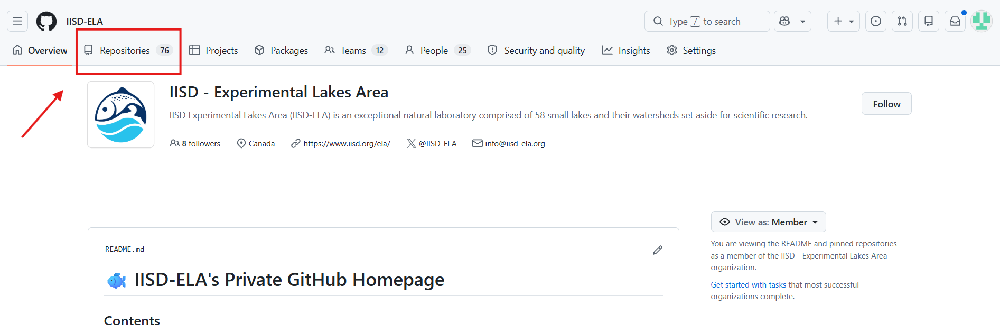
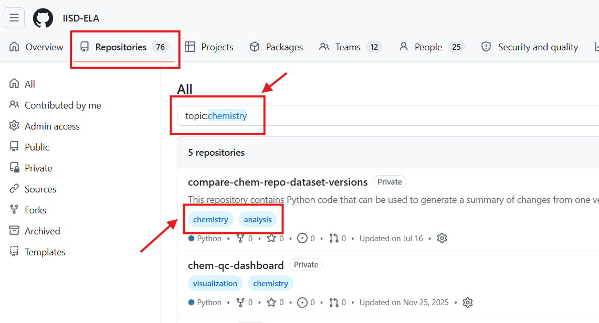
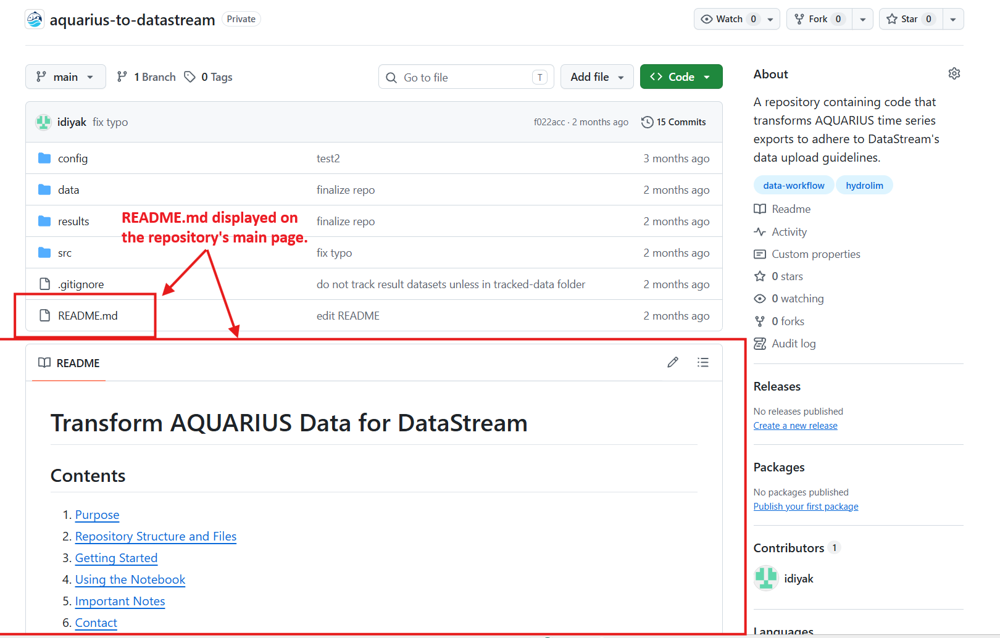

# Level 1 - Tutorial 1 - Navigating the IISD-ELA GitHub

**1. Access the IISD-ELA GitHub organization**  
1. Go to [github.com/IISD-ELA](https://github.com/IISD-ELA) and sign in to your GitHub account.  
2. You'll see our organization's homepage, which contains links to resources, guidelines, and information about how our repositories are organized.
3. Click the **Repositories** tab to browse projects stored under our organization.

<kbd>
    
</kbd>

**2. Browse and search for repositories**  
&nbsp;&nbsp;&nbsp;The repositories tab displays projects belonging to IISD-ELA. You can search for repositories by name or filter them using our standardized **topic tags**. 

&nbsp;&nbsp;&nbsp;For example, to find projects related to chemistry, you can type 

`topic:chemistry`

in the search bar. Or, to search by multiple tags, you can type:

`topic:chemistry topic:analysis`

&nbsp;&nbsp;&nbsp;*For a comprehensive list of all our topic tags, see [Appendix 4 - Topic Tags](../../appendices/appendix-4-topic-tags.md).*

<kbd>
    
</kbd>

**3. Understand Repository Information**  
&nbsp;&nbsp;&nbsp;Each repository has a few key pieces of information. Click a repository's name to open it and explore its contents. Below is an example:  

<kbd>
    
</kbd>

**4. Find Project Documentation**  
&nbsp;&nbsp;&nbsp;Most repositories contain a file called `README.md`, which is typically displayed automatically below the file list on the repository's main page. The `README.md` generally explains what the project is about, what it contains, and how to use it. 
**When exploring an unfamiliar repository, start by reading its `README.md`.**

<kbd>
    
</kbd>
