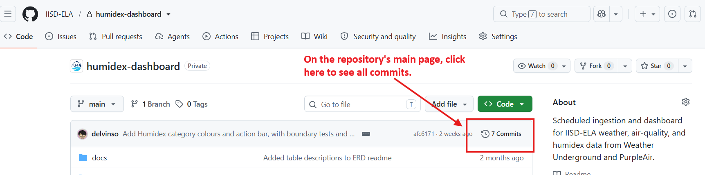
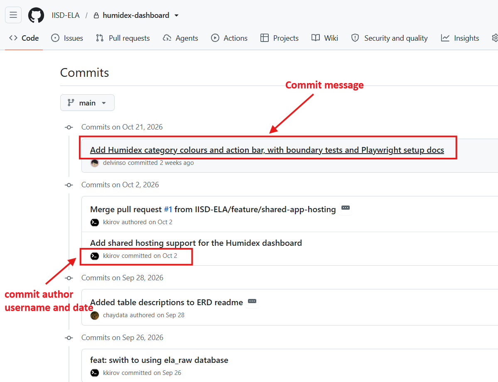

# Level 1 - Tutorial 2 - Understanding our GitHub Repositories

**1. What is a GitHub repository?**  
&nbsp;&nbsp;&nbsp;A repository (or "repo") is essentially a project folder on GitHub. It contains your project's files, folders, documentation, and a history of changes over time. Unlike a regular folder on your computer, a GitHub repository keeps track of previous versions of your files, making it easier to see what changed, when, and by whom. **Each project submitted through our automated system gets its own repository on the IISD-ELA GitHub organization, without duplicates.**

**2. Understanding repository files and folders**  
&nbsp;&nbsp;&nbsp;When you open a repository, you'll see a list of files and folders belonging to the project. Some common files you'll encounter include:

File/Folder | Purpose |
---|---|
`README.md` | The project's main documentation, typically explaining its purpose, contents, and how to use it. |
`.gitignore` | Specifies files Git should ignore when tracking changes, such as temporary or configuration files stored locally on your computer. Think of it as a spam filter for your repository; it prevents useless files (or files that contain sensitive information) from showing up on your GitHub repository. |
`docs/` | Contains additional documentation, instructions, or supporting resources. |
`scrips/` | At IISD-ELA, this typically contains standalone scripts that perform specific tasks, such as an R script for analyzing lake chemistry data or a Python script for generating figures. |
`src/` | At IISD-ELA, this typically contains source code used to build software, applications, or infrastructure-related tools. Typically includes code that is part of a larger, structured system. (i.e., projects developed by the IISD-ELA data team!) |

&nbsp;&nbsp;&nbsp;Of course, your repository may contain additional files and folders depending on the project. Not every project needs all of these.

**3. Understanding Commits and Version History**  
&nbsp;&nbsp;&nbsp;One of GitHub's most useful features is its ability to keep a record of changes made to your project. Each time you save a set of changes to your repository, you create a **commit**. Think of a commit as a saved checkpoint in your project's history. Each commit records: **what changed**, **who made the change**, **when the change was made**, and **a short message** describing the change:
<kbd>
    
</kbd>

<kbd>
    
</kbd>

**4. GitHub repository vs. local folder**  
&nbsp;&nbsp;&nbsp;A regular folder on your computer stores your current files, but doesn't automatically keep a history of every change. A GitHub repository stores your project online along with its version history. You can work directly on files through the GitHub website on your browser, or download a copy (i.e., "clone" the repository) to your computer and work locally using tools such as VS Code or RStudio. We'll cover working locally in level 2.
