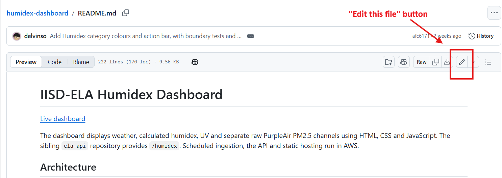
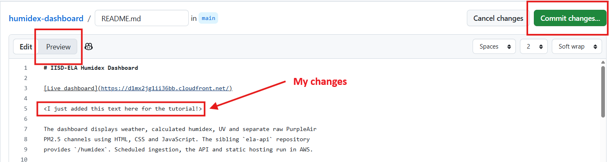
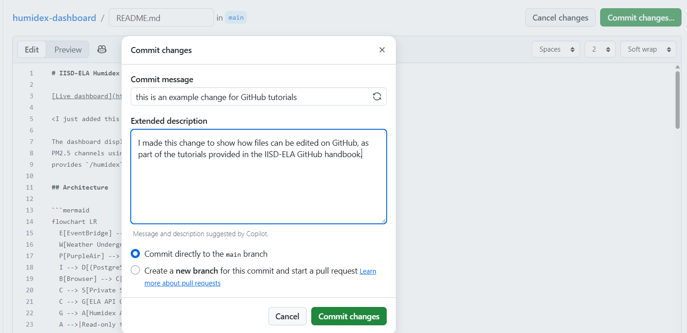
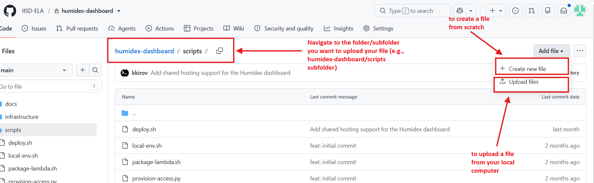
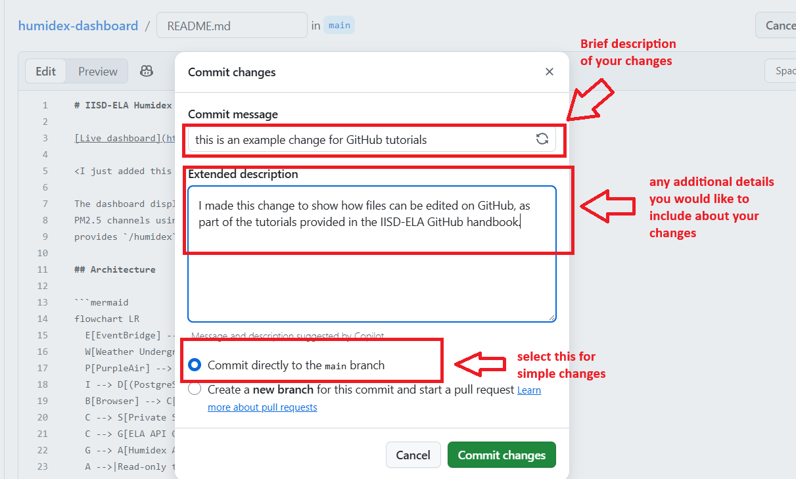

# Level 1 - Tutorial 3 - Editing and Uploading Files Through GitHub

&nbsp;&nbsp;&nbsp;You can make changes to your repository directly through the GitHub website, whether you're updating an SOP, modifying a script, or adding new project files.

**1. Editing an Existing File**
1. Open your repository on GitHub.
2. Click the file you want to edit (e.g., `README.md`).
3. Click the **pencil icon** (Edit this file) near the top-right of the file.
4. Make your changes in the editor.
5. If you're editing a Markdown file (a file with extension `.md`), use the Preview tab to see how your changes will look.
6. Click **Commit changes...** when you're finished.
<kbd>
    
</kbd>

<kbd>
    
</kbd>

<kbd>
    
</kbd>

**2. Uploading new files**  
&nbsp;&nbsp;&nbsp;You can also add new files to an existing repository.
1. Open your repository and navigate to the folder where you'd like to add files.
2. Click **Add file** > **Upload files**.
3. Drag and drop your files into the upload area, or select them from your computer.
4. Click **Commit changes...** to save the uploaded files to your repository.

***Again, please do not upload any files that contain sensitive information (e.g., passwords, keys, credentials), or large datasets (anything over 25MB).***

<kbd>
    
</kbd>

**3. Saving your changes (commits)**  
&nbsp;&nbsp;&nbsp;When you edit or upload files, GitHub asks you to create a **commit**. A commit saves your changes as a new checkpoint in your repository's history.
1. Enter a short, descriptive commit message explaining what you changed.
2. For simple changes, select **Commit directly to the main branch.**
3. Click **Commit changes**.

<kbd>
    
</kbd>

---
***Keep in mind:*** If others are actively working on the same directory, coordinate changes to avoid changes. We'll cover best practice collaborative workflows in Level 3.