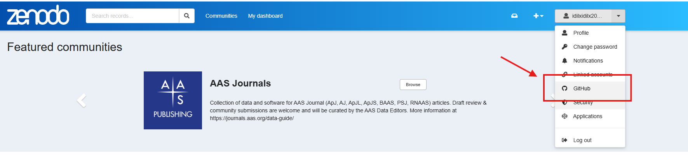
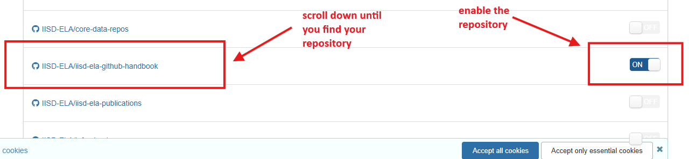
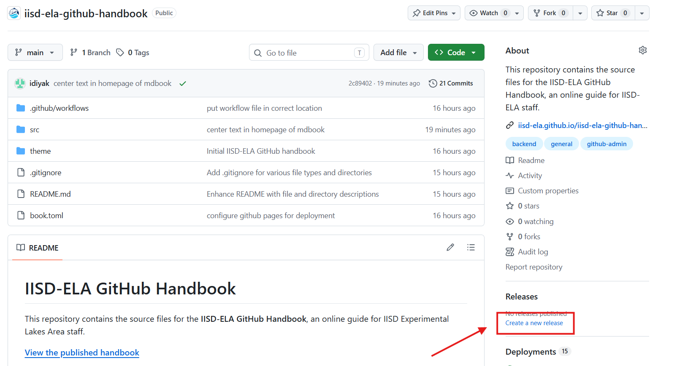
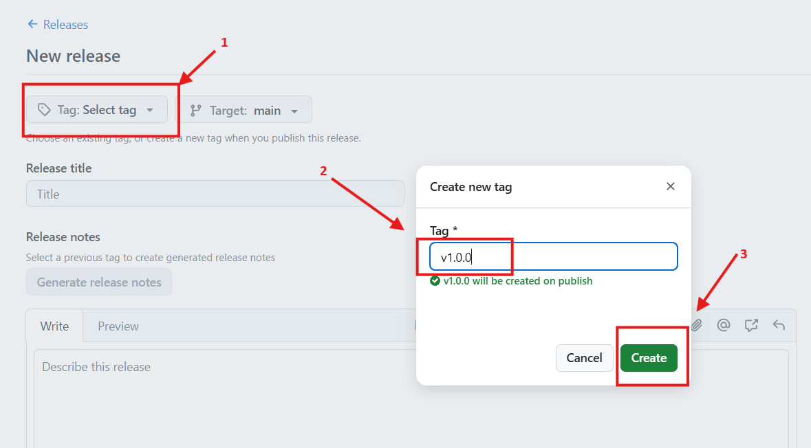
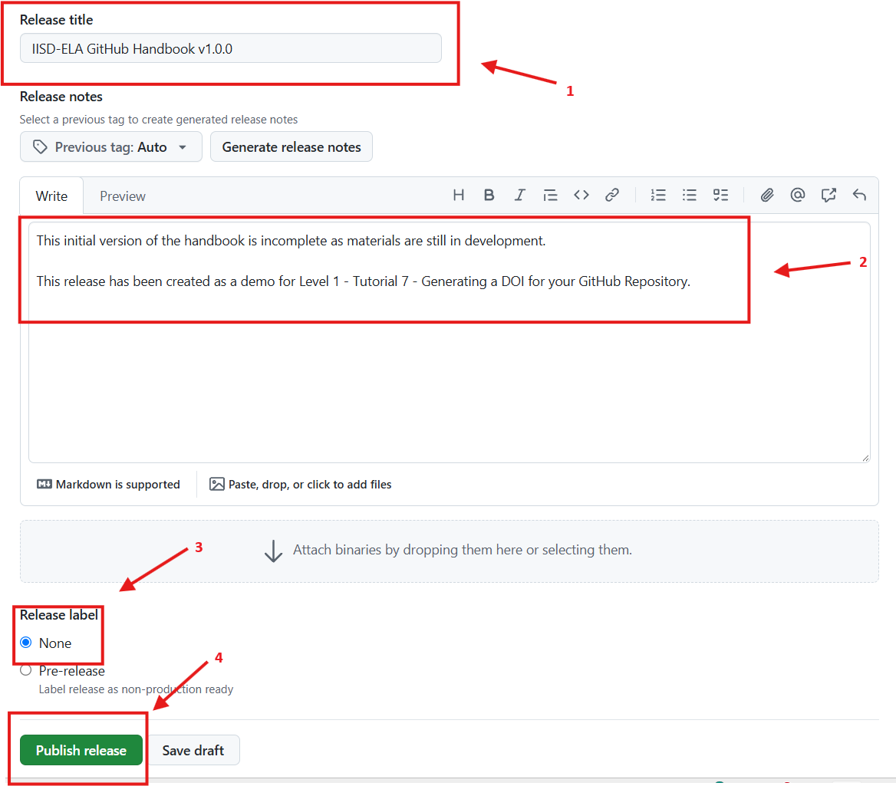
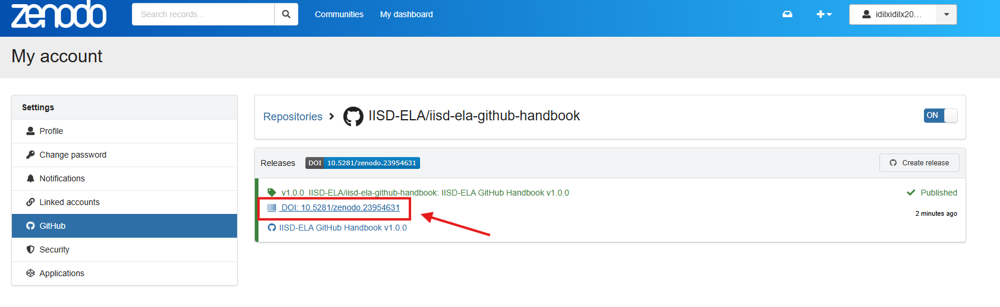
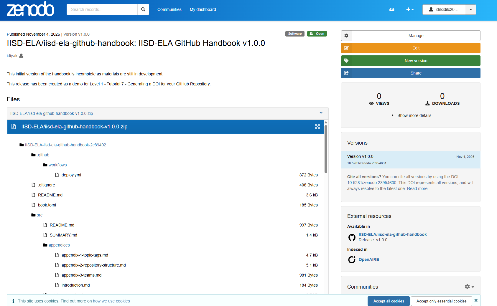

# Level 1 - Tutorial 7 - Generating a DOI for your GitHub repository

&nbsp;&nbsp;&nbsp;If you've developed code, analytical methods, or other research materials that you'd like to reference in a scientific publication, **you can generate a Digital Object Identifier (DOI) for your GitHub repository**. A DOI provides a permanent, citable reference to your work, allowing other researchers to access the exact version used in your research.  
&nbsp;&nbsp;&nbsp;GitHub integrates with Zenodo, a free research repository that archives GitHub releases and assigns them DOIs.

**1. Prepare your repository**
1. Make sure your repository is **public**.  
2. Ensure your `README.md` clearly describes your project and how to use it.  
3. Include an appropriate `LICENSE` file (see [notes on licenses for public repositories](../../appendices/appendix-3-repository-structure.md#notes-on-licenses-for-public-repositories)).
4. Double-check to ensure your repository contains no sensitive information or files that shouldn't be shared with the public.  

**2. Connect your repository to Zenodo**  
1. Visit Zenodo and log in using your GitHub account.
2. Authorize Zenodo to connect to GitHub.
3. Open the GitHub section from your Zenodo profile menu.
4. Click Sync now, if necessary, to refresh the repository list.
5. Find your IISD-ELA repository and enable its integration.

&nbsp;&nbsp;&nbsp; *Note: Because your repository belongs to the IISD-ELA GitHub organization, organization-owner approval may be required to authorize Zenodo. Contact eladata@iisd-ela.org or me directly at iyaktubay@iisd-ela.org if you encounter permission issues.*

<kbd>
    
</kbd>

<kbd>
    
</kbd>

**3. Create a GitHub release**  
&nbsp;&nbsp;&nbsp;Once your repository is connected to Zenodo:
1. Open your repository on GitHub.
2. Under releases, click **Create new release**.
3. Click **Select tag** and create a version tag, such as `v1.0.0`.
4. Give your release a title and a short description.
5. Click **Publish release** (you can choose None as your release label).

&nbsp;&nbsp;&nbsp;Zenodo will automatically archive a snapshot of your repository and generate a DOI.

<kbd>
    
</kbd>

<kbd>
    
</kbd>

<kbd>
    
</kbd>

**4. Find and cite your DOI**  
&nbsp;&nbsp;&nbsp;Return to Zenodo and open your newly archived release.

&nbsp;&nbsp;&nbsp;Zenodo provides two types of DOI:

* **Version DOI:** Identifies one specific release of your repository. Use this when citing code or methods used in a scientific publication, so readers can access the exact version used.
* **Concept DOI:** Represents your project across all its releases. Useful when referring to the project as a whole rather than a specific version.

&nbsp;&nbsp;&nbsp;Zenodo also provides citation information that you can use in your publication's reference list. Review the title, authors, and other metadata before citing.  
&nbsp;&nbsp;&nbsp;You can optionally add the DOI or a DOI badge to your GitHub repository's README.md to make it easier for others to cite your work.

&nbsp;&nbsp;&nbsp;*Here is the link to the Zenodo page for the published repository I used in the example below: [https://doi.org/10.5281/zenodo.23954631](https://doi.org/10.5281/zenodo.23954631)*  

<kbd>
    
</kbd>

<kbd>
    
</kbd>

**5. Publishing Updated Versions**   
&nbsp;&nbsp;&nbsp;If you make significant changes to your project later, you can publish another GitHub release (e.g., `v1.1.0`). Zenodo will archive the new release and assign it a new version-specific DOI, while keeping the same concept DOI for the overall project. This allows different scientific publications to cite the exact versions of your work they used.  
&nbsp;&nbsp;&nbsp;For more information, see [GitHub's official guide to generating DOIs with Zenodo](https://docs.github.com/en/repositories/archiving-a-github-repository/referencing-and-citing-content).