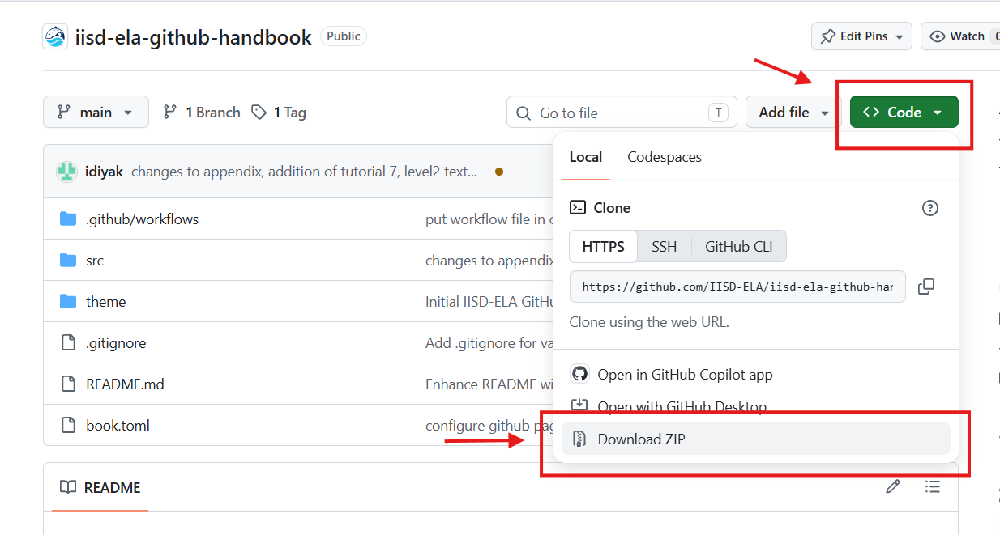

# Level 1 - Tutorial 8 - Downloading a repository to your computer
&nbsp;&nbsp;&nbsp;You can dowload a copy of any repository you have access to as a `.zip` file, without installing any additional software.

1. Open the repository you want to download on GitHub.
2. Click the green Code button above the file list.
3. Select Download ZIP.

Once downloaded, extract the `.zip` file to a folder on your computer.

<kbd>
    
</kbd>

&nbsp;&nbsp;&nbsp;When you download a repository as a `.zip` file, the downloaded files are **independent of the GitHub repository**. In other words, any changes you make locally will not automatically appear on GitHub. The `.zip` file also does not include the repository's version history. If you only need to download and use a project's files, this method may be all you need.

&nbsp;&nbsp;&nbsp;However, if you want to actively develop a project on your computer while maintaining version control and a connection to the GitHub repository, continue to [Level 2:  Version Control - working independently](../level-2.md). There, you will learn how to "clone" repositories using Git and synchronize your changes with GitHub.
