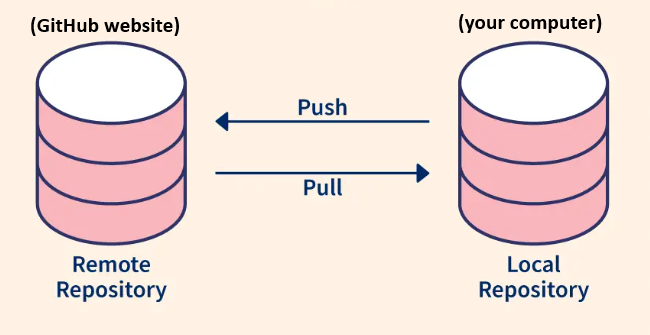

## Level 2 - Tutorial 1 - Introduction to git and local development

### 1. What's the Difference Between Git and GitHub? 

&nbsp;&nbsp;&nbsp;Although they're closely related, **Git and GitHub are two different things:**

- **Git** is a version-control tool software installed on your computer. It tracks changes to your project files, allowing you to save, compare, and recover previous versions.
- **GitHub** is an online platform (a website) that hosts Git repositories, allowing you to store, share, and collaborate on projects.

&nbsp;&nbsp;&nbsp;You can use Git without GitHub, but using them together allows you to work on your projects locally while keeping them connected to the IISD-ELA GitHub organization.

### 2. Local vs. Remote Repositories

&nbsp;&nbsp;&nbsp;When working with Git, you'll encounter two important terms:

- **Local repository:** A copy of your project stored on your computer, where you can edit files and track changes using Git.
- **Remote repository:** The version of your project hosted online on the GitHub website.

&nbsp;&nbsp;&nbsp;Unlike downloading a repository as a `.zip` file ([Level 1 - Tutorial 8](../level1/tutorial-8.md)), **cloning a repository using Git creates a local copy that retains its version history and connection to the remote repository on GitHub.** Your local and remote repositories don't automatically stay synchronized. You'll use Git to exchange changes between them.

<kbd>
    
</kbd>

### 3. Understanding the Basic Git Workflow

Most everyday Git work involves four main actions:

| Action | What it does |
|---|---|
| **clone** | Downloads a GitHub repository to your computer, including its Git history and remote connection. |
| **commit** | Saves a checkpoint of your changes in your local repository. |
| **push** | Uploads your local commits to GitHub. |
| **pull** | Downloads and integrates new changes from GitHub remote repository into your local repository. |

&nbsp;&nbsp;&nbsp;For example, imagine you're maintaining an R script that calculates a certain parameter:

1. **Clone** the repository containing the script to your computer.
2. Edit and test the script in RStudio.
3. Make local changes to the script and **commit** your changes with a message such as `Updated epilimnion calculation`.
4. **Push** your commits to GitHub so the updated script is available online on the GitHub website.

&nbsp;&nbsp;&nbsp;The next time you work on the project, you can **pull** any new changes from GitHub before continuing.

### 4. How Will You Use Git?

&nbsp;&nbsp;&nbsp;Applications such as **RStudio and VS Code** provide graphical interfaces for common Git operations, including committing, pushing, pulling, and viewing changes. In the following tutorials, you will learn how to use these tools to manage your IISD-ELA projects directly from your computer.