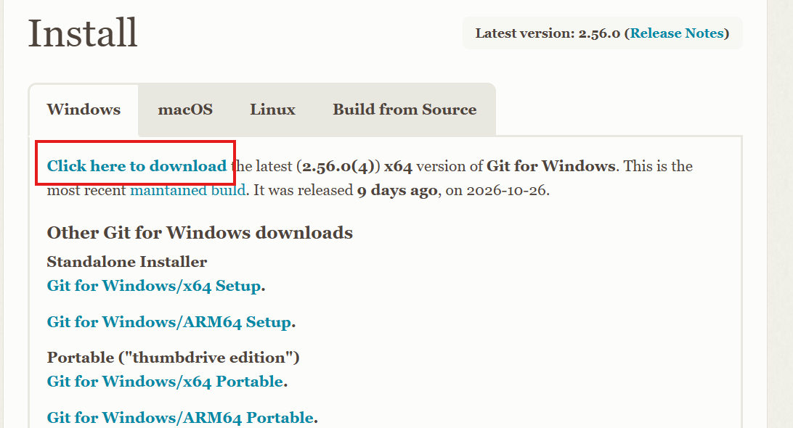
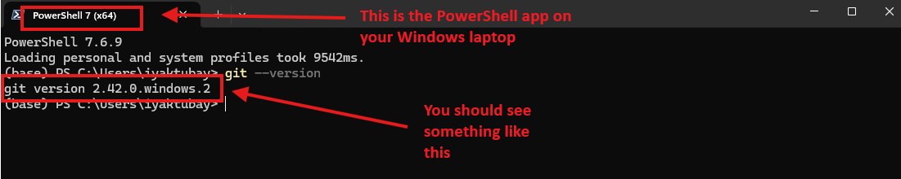
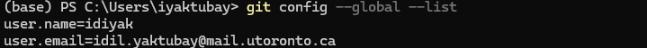
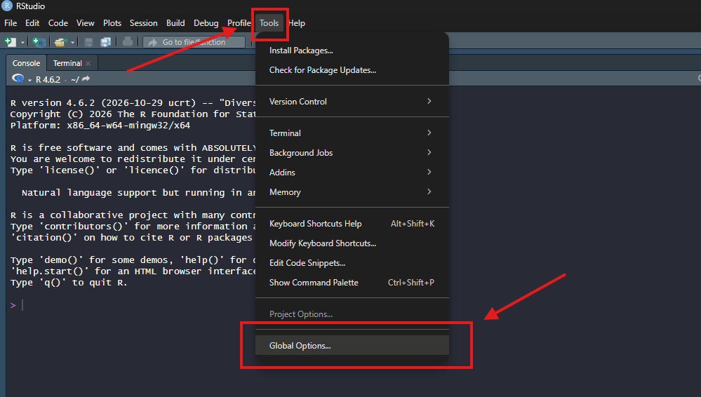
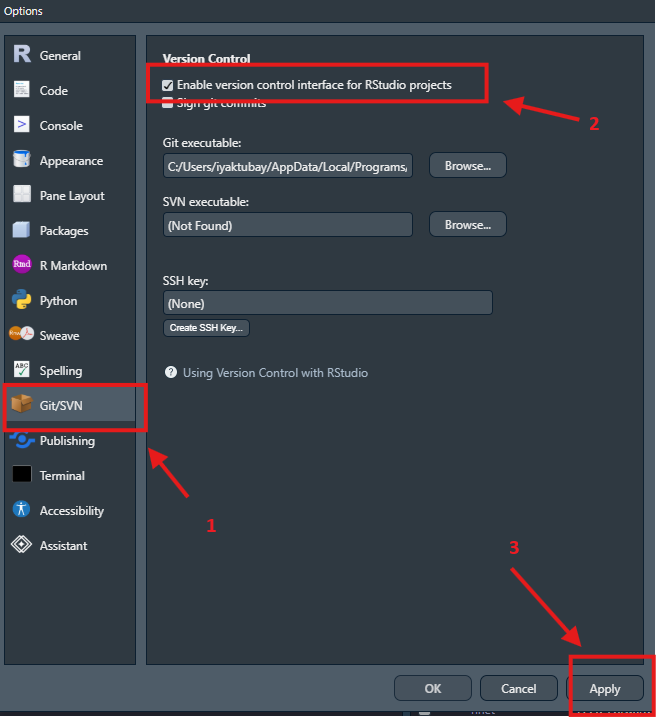
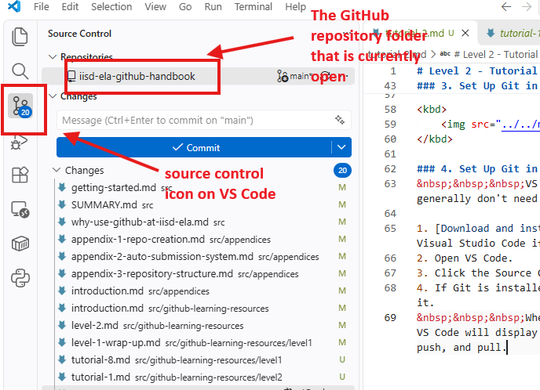

# Level 2 - Tutorial 2 - Setting up your local environment
&nbsp;&nbsp;&nbsp;Before you can use Git to manage projects on your computer, you'll need to install Git and configure it to work with your preferred software. We'll cover setup for both RStudio and VS Code, since many IISD-ELA staff already use RStudio for their work with R.

&nbsp;&nbsp;&nbsp;**If you don't already have either application installed, we recommend installing VS Code.** It offers greater flexibility, supports a wide range of programming languages (including R and Python), and provides more extensive tools for development and version control. You only need to follow the setup instructions for whichever application you choose.

### 1. Install Git

&nbsp;&nbsp;&nbsp;Git is the version-control software that tracks changes to your project files.
1. Visit [git-scm.com/downloads](git-scm.com/downloads).
2. Download and install Git for your operating system (Windows, macOS, or Linux).
3. If you're using Windows, the default installation options are generally sufficient.

<kbd>
    
</kbd>

&nbsp;&nbsp;&nbsp;To confirm that Git was installed successfully, open a terminal (e.g., Git Bash on Windows) and run:

```
git --version
```
You should see the installed Git version displayed.  
<kbd>
    
</kbd>

### 2. Configure your git identity

&nbsp;&nbsp;&nbsp;Git records the name and email address associated with each commit you make. You'll need to configure these once on your computer. Open the PowerShell app if you have not done so already, and run the following commands one by one:

```
git config --global user.name "Your Name"
git config --global user.email "your.email@iisd-ela.org"
```
&nbsp;&nbsp;&nbsp;Ideally, use an email address associated with your GitHub account so your commits are correctly attributed to you. You can verify your settings using:

```
git config --global --list
```
Below is an example output:  
<kbd>
    
</kbd>

### 3. Set Up Git in RStudio 
&nbsp;&nbsp;&nbsp;If you primarily work with R scripts or R projects, you can use Git directly through RStudio.

1. Open RStudio. If you do not have the app installed, install it [here](https://docs.posit.co/ide/user/download.html).
2. Navigate to Tools > Global Options > Git/SVN.
3. Check Enable version control interface for RStudio projects.
4. Confirm that the Git executable field points to your Git installation.
5. Click Apply, then OK. Restart RStudio if prompted.  

&nbsp;&nbsp;&nbsp;Once you open an RStudio project connected to a Git repository, you'll be able to access Git features through RStudio's interface.

<kbd>
    
</kbd>

<kbd>
    
</kbd>

### 4. Set Up Git in VS Code
&nbsp;&nbsp;&nbsp;VS Code includes built-in Git support, so you generally don't need to install additional extensions.

1. [Download and install](https://code.visualstudio.com/download) Visual Studio Code if you haven't already.
2. Open VS Code.
3. Click the **Source Control icon** in the left sidebar.
4. If Git is installed correctly, VS Code should automatically detect it.  

&nbsp;&nbsp;&nbsp;When you open a folder containing a Git repository, VS Code will display its tracked changes and provide options to commit, push, and pull. If you're not sure what it means to "open a folder containing a Git repository", don't worry. This will be covered in the next tutorial.

<kbd>
    
</kbd>
