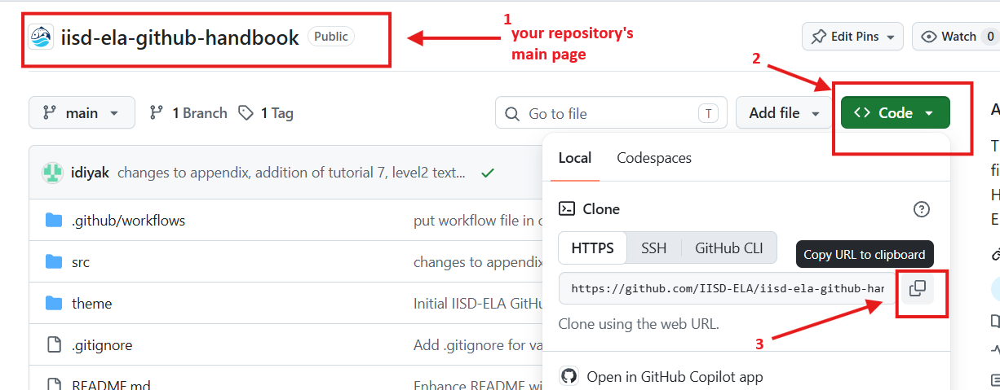
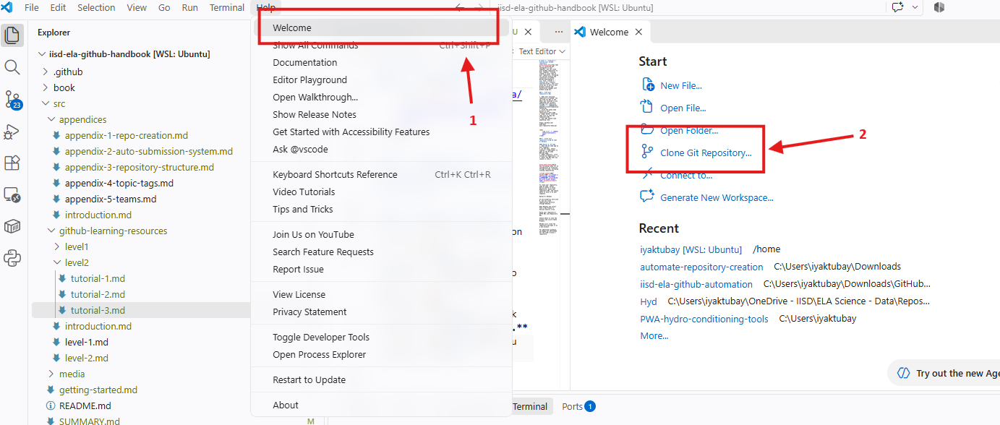
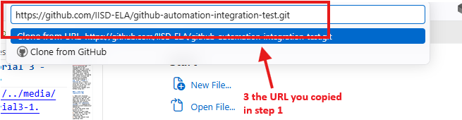
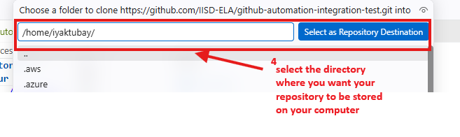
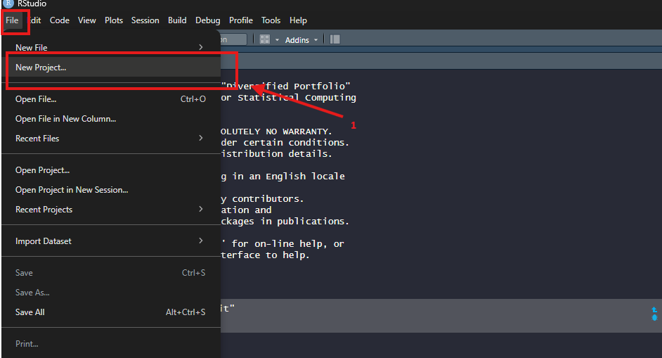
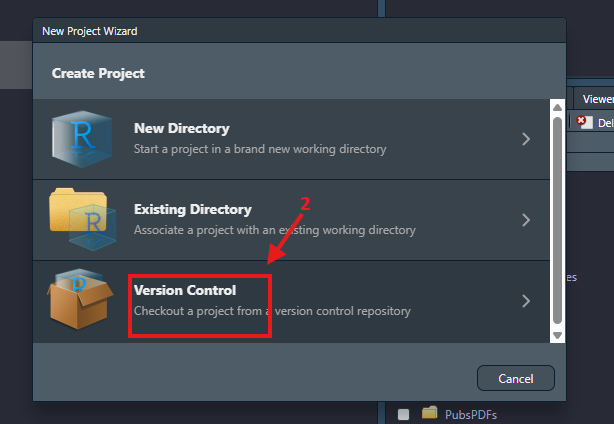
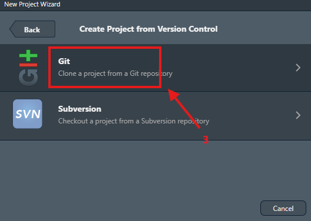
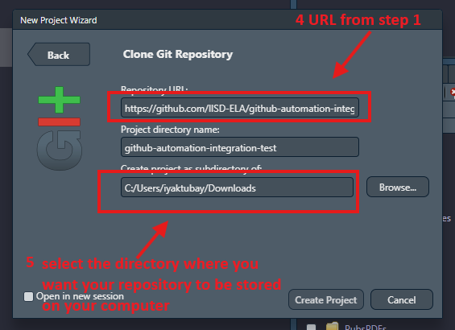

# Level 2 - Tutorial 3 - Cloning your GitHub repository
&nbsp;&nbsp;&nbsp;Now that Git is installed and configured on your computer, you can clone your GitHub repository to your computer. Cloning creates a local copy of your repository, including its version history and connection to GitHub. Unlike downloading a `.zip` file, ([Level 1 - Tutorial 8](../level1/tutorial-8.md)), this will allow you to work on your project locally and synchronize changes with GitHub using Git.

### 1. Find your repository's URL

1. Open your existing repository on GitHub. You can find its URL in the email you received if you submitted your project through [our submission system](../../appendices/appendix-2-auto-submission-system.md).
2. Click the green Code button on your repository's main page.
3. Under HTTPS, click the copy icon to copy the repository URL.
4. Your URL should look something like:
```
https://github.com/IISD-ELA/your-repository-name.git
```

<kbd>
    
</kbd>

### 2. Clone your repository using VS Code or RStudio

#### Option A: VS Code
1. Open the VS Code app on your computer.
2. On the menu, select **Help** > **Welcome** to open up the VS Code Welcome page.
3. Under **Start**, click **Clone Git Repository...**
4. Enter the URL that you copied in step 1.
5. Choose the directory where you want your repository to be stored in your computer.
6. Select **Open** when prompted.

<kbd>
    
</kbd>

<kbd>
    
</kbd>

<kbd>
    
</kbd>


#### Option B: RStudio
&nbsp;&nbsp;&nbsp;You can clone repositories directly through RStudio:

1. Open RStudio and select File > New Project > Version Control > Git.
2. Paste your repository's HTTPS URL into Repository URL.
3. Choose where to save the project and click Create Project.
4. RStudio will clone the repository and open it as a new project.

<kbd>
    
</kbd>

<kbd>
    
</kbd>

<kbd>
    
</kbd>

<kbd>
    
</kbd>

### 3. Confirm your repository is connected

&nbsp;&nbsp;&nbsp;Once cloned, you should see your repository's files and folders on your computer. You should also have access to Git's version-control features through your chosen application:

* VS Code: Open the Source Control panel.
* RStudio: Look for the Git tab in the project pane.

&nbsp;&nbsp;&nbsp;If GitHub prompts you to sign in, follow the authentication instructions to authorize access to your repository.

&nbsp;&nbsp;&nbsp;*Remember, you only need to clone a repository once per computer. Afterward, you can open the same local project folder whenever you want to continue working.*

### 4. Additional Resources for cloning your GitHub repository

* [Using Git with Visual Studio Code (Official Beginner Tutorial) - YouTube](https://www.youtube.com/watch?v=i_23KUAEtUM)
* [Happy Git and GitHub for the useR - Documentation](https://happygitwithr.com/new-github-first)